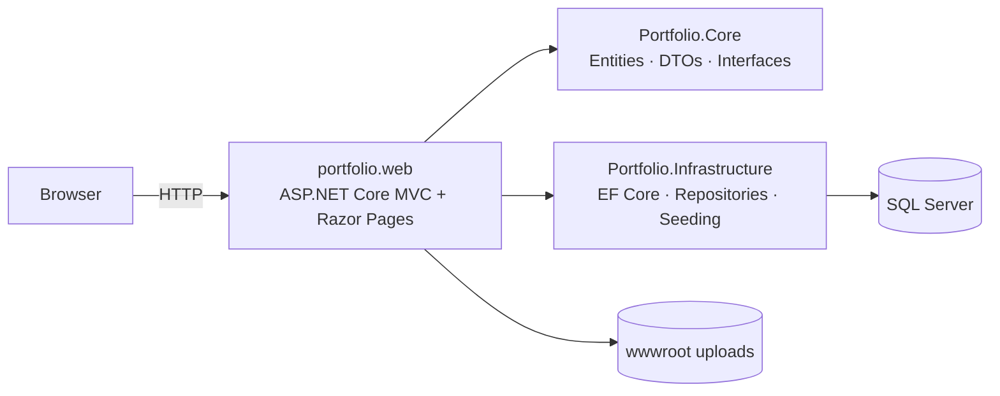

# Ahmed Elgamal — Developer Portfolio

A dynamic, bilingual (English / Arabic) portfolio and content-management system for a full-stack .NET developer. Built with **ASP.NET Core 9 MVC**, **Entity Framework Core**, **SQL Server**, and **ASP.NET Core Identity**.

The public site is fully data-driven: hero typing titles, about, skills, experience, projects, certificates, testimonials, blog posts, social links, navigation sections, colours, and SEO metadata are all managed from a protected admin area.

[](https://dotnet.microsoft.com/)
[](https://www.microsoft.com/sql-server)
[](LICENSE)

---

## Table of contents

- [Features](#features)
- [Architecture](#architecture)
- [Tech stack](#tech-stack)
- [Project structure](#project-structure)
- [Getting started](#getting-started)
- [Configuration](#configuration)
- [Admin account seeding](#admin-account-seeding)
- [Database & migrations](#database--migrations)
- [Continuous integration](#continuous-integration)
- [Security notes](#security-notes)
- [Roadmap](#roadmap)
- [Author](#author)
- [License](#license)

---

## Features

### Public site

- **Dynamic sections** — order, visibility, navbar presence, and custom HTML sections are stored in the database.
- **Bilingual content** — English and Arabic fields for every content type, with RTL layout support and a language toggle.
- **Dark / light themes** — persisted per visitor and configurable by default from site settings.
- **Dynamic branding** — primary/secondary colours and titles are injected as CSS variables.
- **Hero** — typing animation, particles (respects `prefers-reduced-motion`), custom background image, and CV download.
- **About** — profile image, biography, contact details, social links, and CV.
- **Experience timeline** — responsive alternating timeline with current-role support.
- **Skills** — animated proficiency bars split into two columns.
- **Projects** — category filters, “show more”, technology tags, GitHub/demo links, image fallbacks, and click analytics.
- **Certificates** — optional credential cards with issuer, date, and verification link.
- **Testimonials** — star ratings, avatars, and role/company information.
- **Blog** — search, tag filtering, reading-time estimate, syntax highlighting, social sharing, related posts, and view counts.
- **Contact form** — server-side validation, anti-forgery protection, inline success/error feedback, and admin inbox.
- **SEO** — per-page titles/descriptions, Open Graph, Twitter cards, canonical URLs, JSON-LD, `sitemap.xml`, `robots.txt`, and an RSS feed.
- **Accessibility** — skip link, semantic landmarks, visible focus states, ARIA labels, reduced-motion support, and keyboard-friendly navigation.

### Admin area

- Dashboard with project, message, page-view, and blog statistics plus popular projects and recent messages.
- Full CRUD for about, typing titles, skills, experience, project categories, projects, testimonials, certificates, and blog posts.
- Central site settings: branding, colours, theme/language defaults, particles, preloader, SEO, and hero image.
- Section manager: reorder, rename, show/hide, navbar visibility, and custom HTML sections.
- Contact inbox with read state, notes, and deletion.
- Secure image/CV upload with extension, MIME type, size, and magic-byte validation.
- Static portfolio export as a self-contained ZIP.

---

## Architecture



The solution follows a light clean-architecture split:

| Project | Responsibility |
| --- | --- |
| `portfolio.web` | MVC controllers, Razor views, admin area, Identity pages, middleware, static assets |
| `Portfolio.Core` | Domain entities, view models/DTOs, repository contracts |
| `Portfolio.Infrastructure` | `ApplicationDbContext`, EF Core migrations, generic/specialised repositories, database seeding |

Requests flow through controllers → repository interfaces → `ApplicationDbContext`. Public pages are composed from Razor partials per section; the admin area uses a dedicated layout.

---

## Tech stack

- ASP.NET Core 9 MVC + Razor Pages (Identity)
- C# 13, nullable reference types enabled
- Entity Framework Core 9 (code-first migrations)
- SQL Server
- ASP.NET Core Identity with role-based authorization (`Admin`)
- Serilog file logging
- Bootstrap 5, Font Awesome 6, custom CSS/JS
- No front-end build step required

---

## Project structure

```text
portfolio/
├─ Portfolio.Core/
│  ├─ DTOs/                 # View models and request DTOs
│  ├─ Entities/             # EF Core entities
│  └─ Interfaces/           # Repository contracts
├─ Portfolio.Infrastructure/
│  ├─ Data/                 # DbContext, seeding
│  ├─ Migrations/           # EF Core migrations
│  └─ Repositories/         # Generic + specialised repositories
├─ portfolio.web/
│  ├─ Areas/Admin/          # Admin controllers and views
│  ├─ Areas/Identity/       # Login / logout Razor Pages
│  ├─ Controllers/          # Public controllers
│  ├─ Views/                # Public layouts, pages, section partials
│  ├─ Services/             # Upload and slug helpers
│  └─ wwwroot/              # CSS, JS, images, CV, vendor libraries
├─ docs/                    # Architecture/roadmap notes
├─ .github/workflows/       # CI build
├─ LICENSE
└─ README.md
```

---

## Getting started

### Prerequisites

- [.NET 9 SDK](https://dotnet.microsoft.com/download/dotnet/9.0) (or newer with .NET 9 targeting pack)
- SQL Server 2019+ (Express, Developer, or LocalDB)
- Optional: Visual Studio 2022 17.12+ or JetBrains Rider

### 1. Clone

```bash
git clone <YOUR_REPOSITORY_URL>
cd portfolio
```

### 2. Configure the database

Copy the example settings and adjust the connection string:

```bash
cp portfolio.web/appsettings.Example.json portfolio.web/appsettings.Development.json
```

Or set it with user secrets / environment variables:

```bash
cd portfolio.web
dotnet user-secrets init
dotnet user-secrets set "ConnectionStrings:DefaultConnection" "Server=.;Database=PortfolioDB;Trusted_Connection=True;TrustServerCertificate=True;"
```

The default connection string targets a local SQL Server instance:

```json
"Server=.;Database=PortfolioDB;Trusted_Connection=True;TrustServerCertificate=True;"
```

### 3. Restore, build, run

```bash
dotnet restore
dotnet build
dotnet run --project portfolio.web
```

Open the URL printed in the console (default: <http://localhost:5278>).

Migrations and seed data are applied automatically on startup. No manual `dotnet ef database update` is required for a first run.

### 4. Sign in

Navigate to `/Identity/Account/Login`. The administrator account is controlled by the `SeedAdmin` section (see below). Configure it through environment variables or user secrets before exposing the app anywhere.

---

## Configuration

Settings live in `portfolio.web/appsettings.json` and environment-specific overrides.

| Key | Purpose |
| --- | --- |
| `ConnectionStrings:DefaultConnection` | SQL Server connection string |
| `SeedAdmin:Email` | Admin account e-mail created on first run (defaults to `admin@portfolio.local`) |
| `SeedAdmin:Password` | Admin password (must satisfy Identity policy). When empty, a temporary password is generated and logged once |
| `Serilog` | File logging configuration (optional override) |

Use **environment variables** or **user secrets** for credentials. Never commit production passwords.

Example environment variables:

```powershell
$env:SeedAdmin__Email="admin@example.com"
$env:SeedAdmin__Password="<strong-password>"
$env:ConnectionStrings__DefaultConnection="Server=...;Database=...;User Id=...;Password=...;"
```

---

## Admin account seeding

On startup the application:

1. Applies pending EF Core migrations.
2. Ensures the `Admin` role exists.
3. Creates the configured admin account **only when it does not already exist**.
4. Seeds default sections, settings, categories, and portfolio content only when the relevant tables are empty.

If `SeedAdmin:Password` is empty, the app generates a strong temporary password, creates the administrator, and writes the password to the log **once** at warning level. Set `SeedAdmin:Email` and `SeedAdmin:Password` through environment variables or user secrets to avoid this. No credentials are hard-coded and existing accounts are never overwritten.

> The login page deliberately does **not** display credentials.

---

## Database & migrations

Create a migration after changing an entity:

```bash
dotnet ef migrations add <MigrationName> \
  --project Portfolio.Infrastructure \
  --startup-project portfolio.web
```

Apply migrations manually:

```bash
dotnet ef database update \
  --project Portfolio.Infrastructure \
  --startup-project portfolio.web
```

Reset a local database:

```powershell
sqlcmd -S . -Q "ALTER DATABASE PortfolioDB SET SINGLE_USER WITH ROLLBACK IMMEDIATE; DROP DATABASE PortfolioDB;"
```

> The app uses SQL Server only. There is no SQLite fallback.

---

## Continuous integration

`.github/workflows/ci.yml` runs on every push and pull request to `main`:

1. Sets up the .NET 9 SDK on a Windows runner.
2. Restores and builds the whole solution in `Release` configuration.
3. Publishes `portfolio.web` and uploads the output as a build artifact.

The workflow does not need a database: migrations and seeding run at application startup, not during the build. You can run the same checks locally with:

```bash
dotnet restore portfolio.sln
dotnet build portfolio.sln --configuration Release
dotnet publish portfolio.web/portfolio.web.csproj --configuration Release --output publish
```

---

## Security notes

Implemented hardening:

- Anti-forgery validation on all state-changing endpoints, including the public contact form and project click tracking.
- Config-driven admin seeding; no credentials in source or UI.
- Upload validation: extension allow-list, MIME type, size limit, and file-signature (magic byte) checks.
- HTML-encoded output by default; blog rich text is restricted to authenticated admins.
- Security headers (`X-Content-Type-Options`, `X-Frame-Options`, `Referrer-Policy`, `Permissions-Policy`, `X-Permitted-Cross-Domain-Policies`).
- HTTPS redirection and HSTS outside Development.
- Secure, HTTP-only, SameSite cookies.
- Login lockout after five failed attempts for fifteen minutes.
- Rate limiting on the contact form and project-click tracking endpoints.
- Session-scoped page-view de-duplication with crawler and administrator exclusion.
- File uploads validated by extension, content type, size, and magic bytes; filenames are replaced with GUIDs.

Please report vulnerabilities privately — see [SECURITY.md](SECURITY.md).

---

## Roadmap

See [docs/ROADMAP.md](docs/ROADMAP.md) for planned features such as comments, newsletter integration, media library, and richer analytics.

---

## Author

**Ahmed Abdelrahman Elgamal** — Full-Stack .NET Developer

- GitHub: [@elgamalhub](https://github.com/elgamalhub)
- LinkedIn: [ahmed-elgamal1](https://www.linkedin.com/in/ahmed-elgamal1)
- Email: [ahmed.elgamal.dev22@gmail.com](mailto:ahmed.elgamal.dev22@gmail.com)

---

## License

Released under the [MIT License](LICENSE).
